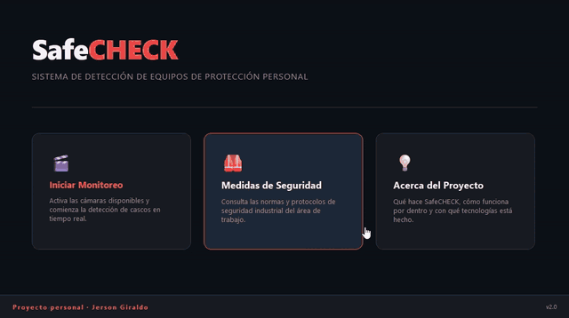
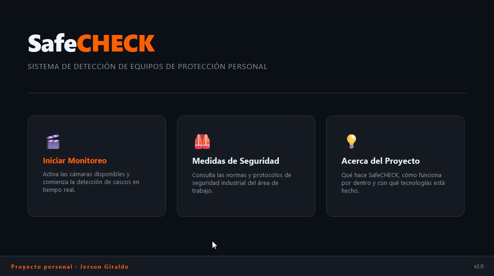
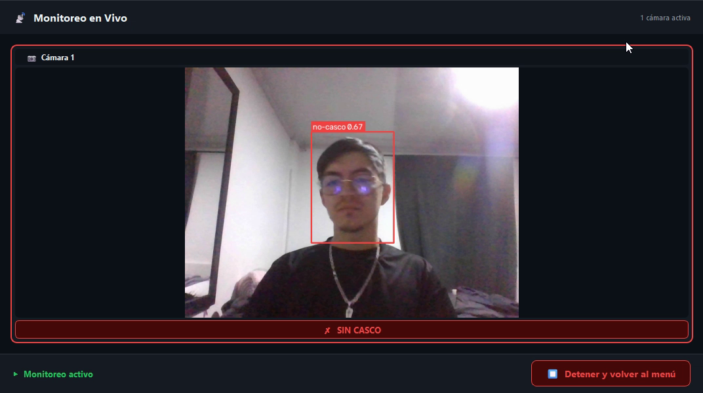

# SafeCHECK 🎥👷‍♂️

SafeCHECK es una aplicación de escritorio multiplataforma desarrollada en **Python** con **PyQt6** y **YOLOv8** para el monitoreo en tiempo real de seguridad laboral, detectando el uso correcto de cascos de seguridad industrial.

Proyecto personal de visión por computador aplicada a la seguridad industrial.



| Menú principal | Monitoreo en vivo |
|---|---|
|  |  |

---

## 🚀 Características

- **Detección en Tiempo Real:** Análisis automático de múltiples cámaras conectadas de forma simultánea.
- **Detección de Cascos (YOLOv8):** Clasificación instantánea (`casco` vs `no-casco`).
- **Arquitectura de Alto Rendimiento:**
  - Captura asíncrona mediante hilos independientes (`FrameGrabber`) para evitar el lag acumulado por búfer de OpenCV.
  - Gestión inteligente de hilos (`QThread`) para evitar congelamientos en la interfaz de usuario (UI).
  - Fallback automático para garantizar ejecución en GPU o CPU según el equipo.
- **Diseño Premium:** Interfaz oscura moderna inspirada en las últimas tendencias visuales.

---

## 🛠️ Requisitos Previos

- **Python 3.10 o 3.11** (las versiones más nuevas pueden no tener todavía paquetes de PyTorch/PyQt6).
- Una cámara web integrada o externa conectada.

---

## 💻 Instalación y Configuración

Sigue estos pasos para instalar y ejecutar el proyecto en cualquier sistema operativo (**Windows**, **macOS**, o **Linux**):

### 1. Clonar el repositorio
Si aún no has descargado el repositorio:
```bash
git clone https://github.com/Jersonflo/SafeCHECK.git
cd SafeCHECK
```

### 2. Crear y activar un entorno virtual
Se recomienda el uso de entornos virtuales para evitar conflictos con otras dependencias globales.

* **En macOS y Linux:**
  ```bash
  python3 -m venv env
  source env/bin/activate
  ```

* **En Windows (CMD / PowerShell):**
  ```cmd
  python -m venv env
  env\Scripts\activate
  ```

### 3. Instalar las dependencias
Instala los paquetes necesarios definidos en `requirements.txt`:
```bash
pip install --upgrade pip
pip install -r requirements.txt
```

---

## 🚀 Ejecutar la Aplicación

Para iniciar SafeCHECK, simplemente ejecuta el archivo principal:

```bash
python main.py
```

---

## ⚙️ Configuración Personalizada

Puedes ajustar el comportamiento del sistema editando el archivo `config.py`:

* **Sensibilidad de la detección:** Cambia `DETECTION_CONFIDENCE` (por defecto `0.55`) para hacer la detección de cascos más o menos estricta.
* **Resolución de cámaras:** Configura `CAMERA_FRAME_WIDTH` y `CAMERA_FRAME_HEIGHT`.
* **Tamaño de inferencia:** `MODEL_IMGSZ` está en `416` para que funcione fluido en CPU. Súbelo a `640` si tienes GPU NVIDIA o si las personas aparecen lejos en la imagen.
* **Frames Skip:** El video siempre se muestra en vivo y YOLO corre en un hilo aparte. Si quieres bajar el uso de CPU, sube `INFERENCE_SKIP_FRAMES` a `2` o `3`.

---

## 📁 Estructura del Proyecto

* **`main.py`**: Punto de entrada de la aplicación.
* **`config.py`**: Parámetros globales y de rendimiento.
* **`core/`**: Motores lógicos.
  - `model_manager.py`: Inicialización de YOLOv8 e inferencia.
  - `camera_manager.py` & `camera_worker.py`: Captura y procesamiento asíncrono de fotogramas.
* **`ui/`**: Interfaz de usuario de PyQt6.
  - `views/`: Vistas de la app (Home, Carga, Grilla de cámaras, etc.).
  - `styles.py`: Hoja de estilos premium (QSS).
* **`models/`**: Contiene el archivo de pesos del modelo YOLO (`best.pt`).

---

## 📄 Licencia

Distribuido bajo la licencia MIT. Consulta el archivo [LICENSE](LICENSE).
